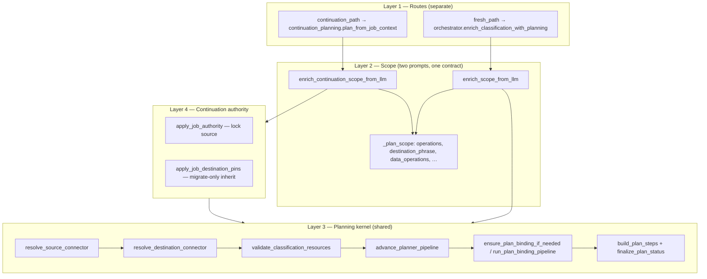

# Continuation planning kernel — implementation plan

**Status:** Canonical (2026-06)  
**Audience:** Engineers changing continuation map/migrate, connector resolution, or planner binding.

Implement from this file together with [`ARCHITECTURE.md`](ARCHITECTURE.md) and [`MODULES.md`](MODULES.md).

---

## North star

**Separate routes, shared kernel** — not one undifferentiated flow.

| Layer | Fresh | Continuation | Shared? |
|-------|-------|--------------|---------|
| **Route / entry** | `classify_and_enrich` → orchestrator | `plan_from_job_context` | No — different inputs |
| **Scope LLM** | `enrich_scope_from_llm` | `enrich_continuation_scope_from_llm` | Same `_plan_scope` **shape**, two prompts |
| **Planning kernel** | bind → clarify → assemble | bind → clarify → assemble | **Yes** |
| **Authority** | PLAN_SCOPE + catalog bind LLMs | `JobContext` locks **source** | Continuation-only |

**Rule:** LLM decides operations, destination phrase, connector/workbook, and entity. Code **validates** against catalog and **binds** IDs. No keyword/regex routing on the planning path.

**Removed (2026-06):** `pipeline_action` template routers (`continue_map_migrate`, `fresh_full_pipeline`, etc.) and `metadata.template`. Continuation mechanical steps are `_continuation_steps` from PLAN_SCOPE + job progress; plans expose `metadata.pipeline_steps` and `metadata.pipeline_label`.

**Non-goals**

- Do not merge Gate 0 or full intent pipeline overlay into continuation.
- Do not use one mega PLAN_SCOPE prompt for fresh + continuation.
- Do not re-bind or re-extract source every continuation turn.
- Do not keep parallel destination/entity resolvers (`map_continuation_destination` fork).

---

## Architecture (target)



**Module:** `services/planning/planning_kernel.py` — `run_planning_kernel(session, *, plan_route, job=None)` called by both routers after scope merge. Source catalog LLM runs **before** destination when `read_needs_source`.

**Existing hooks to reuse (do not duplicate):**

- `should_skip_source_binding` — `continuation_policy.py` + `binding/pipeline.py`
- `should_skip_source_entity_resolver` — `binding/guards.py`
- `advance_planner_pipeline` — destination + entity stages only on continuation
- `clarification_compose` — turn-by-turn clarification loop

---

## Current vs target

| Area | Current (2026-06) | Target |
|------|-------------------|--------|
| Destination connector | `llm_resolve_destination_connector` via `planning_kernel` / `enrich_continuation_destination_connectors` | Same — **account/org/DB only** |
| GS workbook/tab | Entity slot + `pick_workbook` / `resolve_and_apply_google_sheets_workbook` | Not in connector LLM catalog |
| Pre-LLM pins | Clear stale pins; confirm after LLM apply | Same |
| Entity | Shared binding pipeline + `PLAN_BIND_*` | Same |
| Clarifications | `advance_planner_pipeline` + compose | Same |
| Keywords | Removed from hot path; validation-only helpers remain | Audit clean on hot paths |

---

## Decision matrix — LLM vs validate-only

| Decision | LLM | Mechanical (after LLM) |
|----------|-----|-------------------------|
| Pipeline ops (map/migrate/data_ops) | PLAN_SCOPE | `scope_validator`, step resolver |
| `destination_phrase`, `destination_same_as_source` | PLAN_SCOPE | — |
| Destination connector (org / DB / GS account) | `llm_resolve_destination_connector` | `validate_destination_connector_pins`, `apply_destination_connector_pick` |
| GS workbook/tab (map/migrate) | Entity layer — not connector LLM | `pick_workbook`, `resolve_and_apply_google_sheets_workbook`, catalog DB lookup |
| Destination entity | Binding / PLAN_BIND | Catalog shortlist match, confidence gates |
| Source connector/entity (fresh) | Binding pipeline | Catalog match |
| Source (continuation) | **JobContext** — no LLM | `apply_job_authority` |
| Migrate-only after map | **No connector LLM** when `mapping_ready` + no new phrase | `apply_job_destination_pins` (explicit branch) |
| Clarification copy | `clarification_compose` | Slot satisfaction in `op_requirements` |

**Removed from planning path (2026-06):** `apply_resource_hints`, `MAP_MARKERS`, `find_*_destination_in_prompt`, `map_continuation_destination.py`, prompt-based endpoint sanitize.

---

## Phased implementation

### Phase 0 — Invariants and tests

Add failing tests that encode target behavior (can land before refactors):

- Continuation with `destination_phrase` must invoke destination resolver (not skip when phrase ≠ pinned dest).
- No `planner_destination_confirmed` before resolver returns.
- `"move the data to SF 1 XYZ list"` and `"migrate … SF 1 XYZ list"` → same workbook pins.
- `mapping_ready` + migrate-only + no new phrase → inherit job destination without resolver call.

Run: `audit_keyword_routing.py`, continuation test suite (see bottom).

**Definition of done for full project:** Phase 2 complete.

---

### Phase 1 — Kernel correctness on continuation (unblock live bugs)

*Still forked architecture; safe to ship independently.*

1. **Stop stripping scope hints:** remove `base.pop("destination_phrase")` in `enrich_continuation_scope_from_llm` when `active_job_id` is set (keep operations cap separate).
2. **Pre-LLM pins:** in `apply_continuation_endpoint_pins_from_job`, set `destination_same_as_source` flag only — do **not** set `planner_destination_confirmed` / `_destination_endpoint_clarified` until after resolver (or skip resolver when flag is true and source is resolved).
3. **Resolver gate:** run `llm_resolve_destination_connector` when continuation steps include map/migrate and user named a target (`destination_phrase` or infer-from-prompt), even if stale pins exist — clear pins when `goal_requests_new_destination_endpoint`. Workbook phrase → connector LLM for account, then entity workbook bind.
4. **PLAN_SCOPE prompt:** full phrase after “to”; workbook beats org prefix; never `same_as_source` when phrase names a different catalog object.

---

### Phase 2 — Shared planning kernel (main architecture)

**Status:** Landed (2026-06) — `services/planning/planning_kernel.py`

1. **Add** `services/planning/planning_kernel.py`:
   - Input: `PlannerSession` (classification, plan, parsed_goal, prompt), `plan_route`, optional `JobContext`
   - Steps: destination resolver → validate → `advance_planner_pipeline` → binding → return updated session
2. **Continuation router** (`plan_from_job_context`): after scope + `apply_continuation_goal_to_classification` + `apply_job_authority`, call kernel instead of `enrich_continuation_destination_connectors` + `resolve_map_continuation_destination` fork.
3. **Fresh router** (`enrich_classification_with_planning`): after scope + `apply_label_phrases_from_goal` replacement, call same kernel (or fold kernel into existing tail after scope).
4. **`advance_planner_pipeline`:** derive source-stage skip from `should_skip_source_binding` / `plan_route == continuation_path` — do not duplicate stage lists.
5. **Clarification reuse:** if `planner_pending` / `awaiting_clarification` already pins connector or entity, do not re-run destination LLM (ARCHITECTURE known gap).
6. **Retire** most of `map_continuation_destination.py` — keep thin helpers or move to `continuation_policy.py`.
7. **Migrate-only inherit:** keep explicit branch in continuation router *before* kernel when `continuation_should_inherit_job_destination`.

---

### Phase 3 — Keyword retirement and fresh parity

**Status:** Complete (2026-06)

1. Deleted `apply_resource_hints`, `apply_all_resource_hints`, `find_*_destination_in_prompt`, and prompt-based endpoint sanitize from planning hot paths.
2. `resource_resolver.py` and `endpoint_resolver.py` retain validation/catalog-match helpers only.
3. `scripts/audit_keyword_routing.py` forbids removed symbols and keyword resolver imports on hot paths.
4. Multi-source detection uses PLAN_SCOPE `extract_sources[]` only (no regex fallback).

---

### Phase 4 — Session context and observability

1. Reuse `session_facts.enrich_destination_phrase_from_conversation_if_needed` on continuation when phrase is ambiguous (“that sheet”).
2. Structured logs: `continuation_bind stage=connector|entity skipped=<reason>`, PLAN_SCOPE output fields.
3. Update [`ARCHITECTURE.md`](ARCHITECTURE.md) continuation diagram to target state only after Phase 2 lands.

---

## Explicit continuation branches (not keyword routing)

| Condition | Behavior |
|-----------|----------|
| `destination_same_as_source: true` from PLAN_SCOPE | Catalog destination LLM picks matching `workbook_name` / `display_name` from job context |
| `destination_phrase` names new target | Clear stale dest pins; always run connector LLM |
| `steps == ["migrate"]` + `mapping_ready` + no new phrase | `apply_job_destination_pins` — no connector LLM |
| Clarification turn with connector already pinned | Reuse pin; do not re-run connector LLM |
| Source connector/entity | Always from `JobContext`; `should_skip_source_binding` |

---

## File change map

| File | Phase | Action |
|------|-------|--------|
| `planning/planning_kernel.py` | 2 | **Add** shared kernel |
| `intent/continuation_planning.py` | 1–2 | Call kernel; slim router |
| `planning/connector_llm_resolver.py` | 1 | Connector-only destination/source resolver (`llm_resolve_destination_connector`) |
| `planning/goal_parser.py` | 1 | Fix phrase stripping; prompts |
| `planning/continuation_policy.py` | 1 | Pre-LLM: clear pins only |
| `planning/connector_guards.py` | 1 | Split “needs resolution” vs “confirmed after apply” |
| `planning/label_aware_resolver.py` | 3 | **Deleted** — replaced by source/dest catalog LLM in kernel |
| `intent/classify.py`, `classifier_prompt.py`, `classifier_scope.py` | 3 | **Deleted** — S01 bootstrap + PLAN_SCOPE only |
| `planning/clarification_pipeline.py` | 2 | Continuation source-stage skip |
| `planning/orchestrator.py` | 2–3 | Call kernel after scope |
| `planning/google_sheets_destination.py` | 1–3 | LLM name → DB lookup only |
| `planning/resource_resolver.py` | 3 | Remove from planner hot path |
| `docs/ARCHITECTURE.md` | 2–4 | Target diagrams |

---

## Tests

```bash
cd edison-ai/backend
python scripts/audit_keyword_routing.py
pytest tests/test_continuation_path.py \
       tests/test_continuation_compound.py \
       tests/test_google_sheets_destination_continuation.py \
       tests/test_connector_llm_resolver.py \
       tests/test_plan_binding.py \
       tests/test_migrate_continuation.py -q
```

**Integration scenarios (manual / E2E):**

- SF extract → “move to SF 1 XYZ list” → plan shows Google workbook (not SF Contact).
- SF extract → map to SF 2 → entity Contact → approve.
- Migrate-only after map → inherits mapped destination without connector re-pick.
- Two-turn clar: connector answer turn 1 → entity answer turn 2 (no connector overwrite).

---

## Rollout

Optional flag `continuation_unified_kernel=true` for one release; default on when Phase 2 tests pass. Phase 1 may ship alone as a correctness patch.
