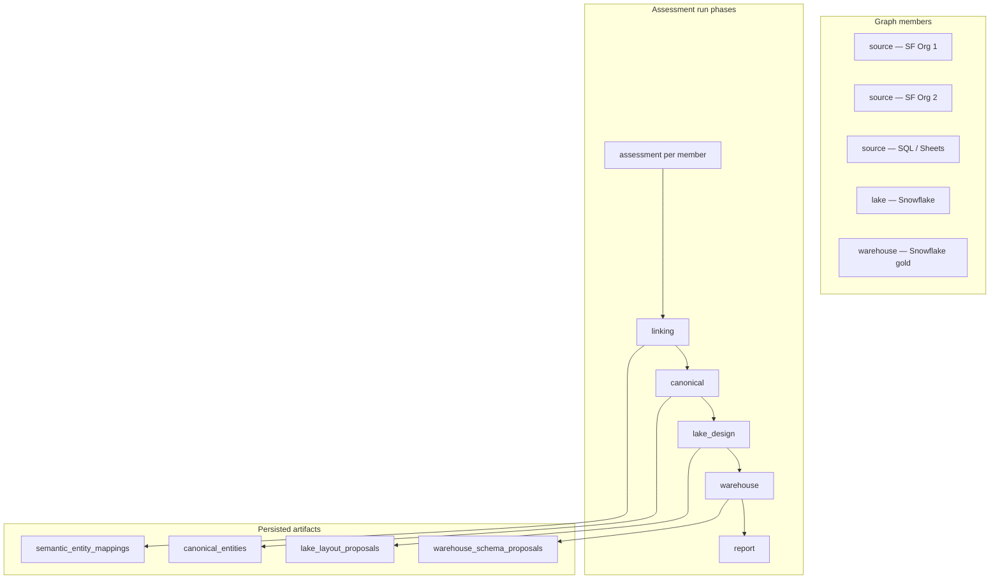
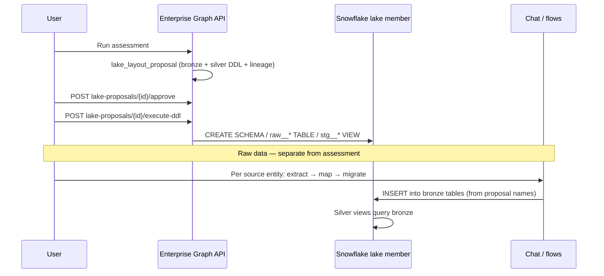

# Data Lake Implementation Plan

> **EGA intelligence:** Lake proposals are now **LLM-first** (`EGA_LAKE_DESIGN`) with rules fallback. See [ENTERPRISE_GRAPH_IMPLEMENTATION_PLAN.md](./ENTERPRISE_GRAPH_IMPLEMENTATION_PLAN.md) § Intelligence architecture.

**Branch:** `feature/dataLakeImplementation`  
**Status:** In progress (2026-06, revised — proposal-only v1, flows for data movement)  
**Scope:** Snowflake-native medallion (bronze → silver → gold) inside Enterprise Graph

**Related docs:** [ARCHITECTURE.md](./ARCHITECTURE.md) (chat architect), [ENTERPRISE_GRAPH_IMPLEMENTATION_PLAN.md](./ENTERPRISE_GRAPH_IMPLEMENTATION_PLAN.md) (stale artifacts, canonical prune, assessment UX), [edisonai-frontend/docs/ARCHITECTURE.md](../../../edisonai-frontend/docs/ARCHITECTURE.md) (command vs event model)

This plan mirrors the existing **warehouse** pattern (`warehouse_designer.py`, `warehouse_schema_proposals`, approve + execute DDL) and inserts a **lake** phase between canonical build and warehouse design.

**v1 product split:** Enterprise Graph delivers the **lake layout proposal** (bronze raw landing + silver views, DDL, lineage). **Raw data** lands in bronze via **chat flows** (extract → map → migrate → save flow) — not via graph bulk-load APIs.

---

## Enterprise Graph vs Chat Architect (boundary)

| Concern | Enterprise Graph (EGA) | Chat architect |
|---------|------------------------|----------------|
| Entry | `POST /api/enterprise-graphs/...` | `POST /architect/stream`, `POST /conversations/{id}/actions/*` |
| Session | Graph run + proposal on `enterprise_graph_runs` | Redis `ConversationSession` |
| Lake design | `lake_designer` → deterministic `source_to_lake_map` + DDL | N/A |
| Infrastructure | Approve + **execute DDL** on lake Snowflake member | N/A |
| **Raw data loads** | **Out of scope v1** — proposal defines *where* raw goes | Extract → map → migrate → **save flow** into bronze tables |
| Mapping for loads | `source_to_lake_map` is the **blueprint** (lineage doc) | `map_fields` → `conversation_migration_contexts` / saved flow mappings |
| Progress UI | `assessmentSse.js` + `EnterpriseGraphAssessment` | Chat SSE + `ChatUploader` |

EGA answers: *“What should our lake look like for these N sources?”*  
Chat answers: *“How do I run and repeat extract → bronze loads?”*

Do **not** route graph assessment through `/architect/stream` or chat action APIs. Do **not** build headless `MigrationService` orchestration in EGA for v1.

---

## Medallion layers (what “raw” means here)

| Layer | In this product | Holds |
|-------|-----------------|--------|
| **Bronze** | `raw__{member_slug}__{entity_slug}` tables in lake Snowflake schema | **Raw / landing data** — source-shaped rows, minimal transform; optional `VARIANT payload` when schema unknown. GSheets slugs use **workbook + tab** from `display_label`, never `spreadsheet_id` (see EGA doc § Lake bronze naming). |
| **Silver** | `stg__{domain}__{entity}` views | Conformed view over bronze (`UNION ALL` per canonical entity via semantic mappings) |
| **Gold** | Warehouse proposal (`fact_*` / `dim_*`) | Star schema for analytics |

The **lake proposal creates bronze table DDL** — that is where raw data is stored. Assessment inventory and proposal JSON are **not** raw data; they are metadata. After **execute DDL**, bronze tables exist (empty) until chat flows insert rows.

File-based raw (S3 + `COPY INTO` / external tables) is out of v1 scope.

---

## Goals

| Goal | Success criteria |
|------|------------------|
| Multi-source landing zone **design** | Each source entity → bronze table + column map in `source_to_lake_map` |
| Conformed silver layer **design** | Silver view DDL aligned to canonical entities + semantic mappings |
| Executable infrastructure | User can approve → execute DDL on Snowflake **lake** member |
| **Raw data in bronze** | User loads via **chat flows** targeting bronze table names from proposal (documented UX; not EGA-automated) |
| Gold unchanged in spirit | Warehouse designer reads **silver**, not live connectors, when lake is enabled (P5) |

---

## Architecture (target state)





**Recommended user order:** run assessment → approve lake DDL → execute DDL → create/run chat flows into bronze → (optional) warehouse DDL on gold member.

---

## Data model

### New table: `lake_layout_proposals`

Parallel to `warehouse_schema_proposals` (`add_lake_layout_proposals.sql`).

| Column | Type | Notes |
|--------|------|-------|
| `id` | UUID PK | |
| `graph_id` | UUID FK | |
| `run_id` | UUID FK nullable | |
| `version` | INT | Monotonic per graph |
| `dialect` | VARCHAR(32) | `snowflake` v1 (default); `logical` preview |
| `logical_model` | JSONB | `{ bronze_tables[], silver_views[], zones, summary }` |
| `source_to_lake_map` | JSONB | `{ member_id, entity_id }` → bronze table + column mapping (lineage) |
| `load_spec` | JSONB | **Optional metadata** per map entry (mode, batch_size); not used by EGA loads in v1 |
| `ddl_text` | TEXT | Bronze + silver DDL only (no INSERT/COPY) |
| `rationale` | TEXT | |
| `gaps` | JSONB | Unmapped sources, missing silver views, etc. |
| `status` | VARCHAR(24) | See lifecycle below |
| `load_status` | JSONB nullable | Reserved for future bulk-load feature; unused in v1 |
| `created_at` / `updated_at` | TIMESTAMPTZ | |

**Status lifecycle (v1):**

```
draft → approved → ddl_executed
                  ↘ superseded (on new proposal)
                  ↘ failed (DDL error)
```

### Graph settings (extend `enterprise_graphs.settings`)

```json
{
  "lake_enabled": true,
  "lake_bronze_schema": "acme_bronze",
  "lake_silver_schema": "acme_silver",
  "warehouse_dataset": "acme_gold"
}
```

### Member role: `lake`

- `MEMBER_ROLES` / `MemberRole`: `source`, `warehouse`, `reference`, **`lake`**
- **Constraints (v1):**
  - At most **one** `lake` member per graph.
  - `lake` member must be `connector_type=sql` with Snowflake connector subtype.
  - `warehouse` member optional but recommended when lake is enabled.
  - **File uploads** are chat-only; file as graph source member is out of v1.

---

## Backend modules (new / changed)

| File | Action | Status |
|------|--------|--------|
| `db/migrations/add_lake_layout_proposals.sql` | Table + indexes | Done |
| `services/enterprise_graph/config.py` | `lake` role, schemas, `lake_enabled()`, `should_run_lake_phase()` | Done |
| `services/enterprise_graph/models.py` | `MemberRole` includes `lake` | Done |
| `services/enterprise_graph/validation.py` | Lake member validation | Done |
| `services/enterprise_graph/lake_designer.py` | Bronze/silver model, map, DDL | Done |
| `services/enterprise_graph/store.py` | Lake proposal CRUD | Done |
| `services/enterprise_graph/linking.py` | `run_lake_proposal_for_graph`, report section | Done |
| `services/enterprise_graph/job_worker.py` | Lake phase after canonical | Done |
| `services/enterprise_graph/run_progress.py` | `lake` phase + sub-steps | Done |
| `services/enterprise_graph/report_builder.py` | `lake_proposal` section | Done |
| `services/enterprise_graph/routes.py` | List/get/approve/execute-ddl | Done |
| `services/enterprise_graph/warehouse_designer.py` | When lake enabled, lineage reads **silver** | Done |
| ~~`lake_load_orchestrator.py`~~ | — | **Removed from v1** |
| ~~`lake_extract_binding.py`~~ | — | **Removed from v1** |

### `lake_designer.py` responsibilities

1. **Bronze (raw landing)** — one table per `(source_member, source_entity)`:
   - Naming: `raw__{member_slug}__{entity_slug}`
   - Columns: `_archian_*` lineage + typed columns from assessment, or `VARIANT payload`
2. **`source_to_lake_map`** — deterministic column lineage to bronze (blueprint for chat flows).
3. **Silver** — one view per canonical entity cluster:
   - Naming: `stg__{domain}__{entity_slug}`
   - SQL: `UNION ALL` across bronze tables via semantic mappings
4. **`generate_lake_ddl`** — `CREATE SCHEMA`, `CREATE TABLE` (bronze), `CREATE OR REPLACE VIEW` (silver)
5. **`load_spec`** — optional per-map metadata; **not** required for v1 (no EGA execute-loads)

**v1:** Rules-based designer only (no LLM silver SQL).

### API routes (mirror warehouse — v1)

| Method | Path | Behavior |
|--------|------|----------|
| GET | `/{graph_id}/lake-proposals` | List versions |
| GET | `/{graph_id}/lake-proposals/latest` | Latest proposal |
| GET | `/{graph_id}/lake-proposals/{id}` | Single proposal |
| POST | `/{graph_id}/lake-proposals/{id}/approve` | Status → `approved` |
| POST | `/{graph_id}/lake-proposals/{id}/execute-ddl` | Run `ddl_text` on **lake** Snowflake member |
| POST | `/{graph_id}/runs` | `run_type=lake_redesign` (P5; mirror `warehouse_redesign`) |

Reuse patterns from `execute_warehouse_proposal` in `routes.py`.

### Pipeline phase order

```
linking (86–88) → canonical → lake (88–91) → warehouse (91–96) → report → done
```

| Phase | Sub-steps (examples) |
|-------|----------------------|
| lake_design | `lake_context`, `lake_bronze`, `lake_silver`, `lake_ddl`, `lake_save` |

**Gate:** Skip lake when `settings.lake_enabled` is false or no `lake` member.

**Remap runs:** When `lake_enabled`, rerun lake proposal after canonical (same as warehouse) — P5.

### Warehouse integration (P5)

When `lake_enabled` and latest lake proposal has `status = ddl_executed` (bronze/silver objects exist):

- `build_source_to_warehouse_map` targets **silver view columns** from `lake_layout_proposals.logical_model`.
- Gaps if silver view missing for a canonical entity used in star schema.

When lake disabled, behavior is identical to today.

### Chat flows → bronze (documented UX, not EGA code)

For each `source_to_lake_map` entry:

1. In chat: extract from the graph source connector / entity.
2. Map fields to the **bronze table and columns** named in the proposal (`bronze_table`, `column_map`).
3. Migrate with destination = lake Snowflake SQL connector, table = bronze table.
4. Save flow for repeat runs / scheduling (existing flow product).

**Alignment note:** Chat uses `conversation_migration_contexts` / saved flow mappings; the lake proposal is the **naming and lineage contract**. Users (or future “spawn flow from map entry”) must target proposal table names.

---

## Frontend (`edisonai-frontend`)

| File | Action | Status |
|------|--------|--------|
| `hooks/useLakeProposal.js` | Load, approve, execute DDL | Done |
| `components/lake/LakeProposalParts.js` | Bronze/silver, DDL, lineage, gaps | Done |
| `components/EnterpriseGraphResultsTabs.js` | Lake tab | Done |
| `components/enterpriseGraphProgress.js` | Lake phase labels | Done |
| Graph create/edit UI | Role **Lake (Snowflake)** + `lake_enabled` setting | Done |
| Lake tab copy | Hint: “Load raw data via chat flows into bronze tables below” | Done |

**No v1 UI for:** bind-extracts, execute-loads, `load_status` polling.

SSE: reuse `streamEnterpriseGraphRun` for assessment and `lake_redesign` (P5).

---

## Testing

| Test | Location | Status |
|------|----------|--------|
| `test_enterprise_graph_lake_designer.py` | Bronze naming, map, DDL | Done |
| `test_enterprise_graph_lake_config.py` | `lake_enabled`, phase gate | Done |
| `test_lake_proposal_section_in_snapshot` | Report builder | Done |
| `test_lake_member_validation` | Rejects non-Snowflake, duplicate lake | Done |
| `test_warehouse_reads_silver_when_lake` | Warehouse source map from silver | Done |
| `test_normalize_lake_ddl` | Schema rewrite on execute | Done |
| `test_pipeline_includes_lake_phase` | `job_worker` with `lake_enabled` | Optional |
| `test_execute_lake_ddl` | Mock Snowflake connector integration | Optional |

---

## Rollout phases

### P0 — Schema & types ✅

Migration, `lake` role, validation, graph settings keys.

### P1 — Lake designer + persistence ✅

`lake_designer.py`, store CRUD, pipeline phase, report section, progress labels, GET/list/latest routes.

### P2 — Execute DDL ✅

Approve + execute-ddl on lake Snowflake member; status → `ddl_executed`.

### P3 — Frontend polish (remaining P4 work)

- Lake member role in graph wizard / canvas
- `lake_enabled` toggle in graph settings
- UX copy linking bronze tables to chat flows
- Optional: export lineage JSON for flow setup

### P4 — Warehouse bridge + docs (was P5)

- Warehouse reads silver when lake enabled
- `ARCHITECTURE.md` medallion / EGA section
- `lake_redesign` run type + `run_graph_remap_job` lake rerun

### Deferred (post-v1, only if users need one-click graph loads)

- `bind-extracts` / `execute-loads` / `lake_load_orchestrator`
- `extraction_job_id` binding on proposal
- `load_status` lifecycle (`loads_running`, `complete`)

---

## Out of scope (v1)

- EGA bulk extract/load orchestration (P3a/P3b — **removed from plan**)
- External object storage / `CREATE STAGE` / `COPY INTO` from S3
- dbt / Airflow scheduling
- Non-Snowflake lake targets
- LLM-generated silver transform SQL
- Real-time CDC / streaming
- **File as graph source member**
- Automatic sync between `source_to_lake_map` and saved flow mappings (manual alignment for v1)

---

## Dependencies & risks

| Risk | Mitigation |
|------|------------|
| Users don’t know how to load bronze | Lake tab documents table names; link to chat flow docs; optional export |
| Chat mapping ≠ proposal `column_map` | Proposal is blueprint; flows must target bronze table/column names from proposal |
| Empty silver views until bronze has data | Document order: execute DDL → chat flows → query silver / warehouse |
| Large bronze UNION views slow | v1 as views; post-v1 materialized silver tables |
| Graph member limit (5) | Lake counts as 1 member; layout: N sources + 1 lake + 1 warehouse |
| Warehouse DDL before bronze populated | Warehouse DDL on empty silver is OK; loads via flows first |

---

## Implementation checklist

1. ✅ P0 migration + `lake` role + validation  
2. ✅ P1 `lake_designer` + pipeline phase + list routes + report/progress  
3. ✅ P2 approve + execute-ddl  
4. ✅ P3 FE: wizard lake member, `lake_enabled`, flows guidance copy  
5. ✅ P4 warehouse silver bridge + `lake_redesign` + ARCHITECTURE.md  

**Apply migration:** `psql $DATABASE_URL -f db/migrations/add_lake_layout_proposals.sql`

Track with Cursor todos (`lake-*`) during implementation.

---

## EGA artifact freshness (2026-06)

When graph **members** change, lake and warehouse proposals from the prior assessment are **stale** until the user runs assessment again. See [ENTERPRISE_GRAPH_IMPLEMENTATION_PLAN.md](./ENTERPRISE_GRAPH_IMPLEMENTATION_PLAN.md) for:

- `assessment_stale` graph setting after canvas save
- Canonical entity prune (fixes orphan Salesforce tables in warehouse proposal)
- Proposal version picker and GSheets scope UX (P2–P3)
- Semantics-first inventory filter (P6) — metadata/system tables excluded from bronze candidates
- Deterministic bronze naming via `bronze_table_name()` / `lake_validator.py`

### Bronze naming examples (P6)

| Source | `display_label` | Bronze table |
|--------|-----------------|--------------|
| SQL `users` | `users` (semantics: Customer Records) | `raw__test_db__customer_record` |
| GSheets | `Archian Data / Sheet1` | `raw__archian_ai__archian_data_sheet1` |
| GSheets (old) | `spreadsheetId::Sheet1` slugified | ~~`raw__archian_ai__1ky6aowc..._sheet1`~~ — **rejected** by validator |
