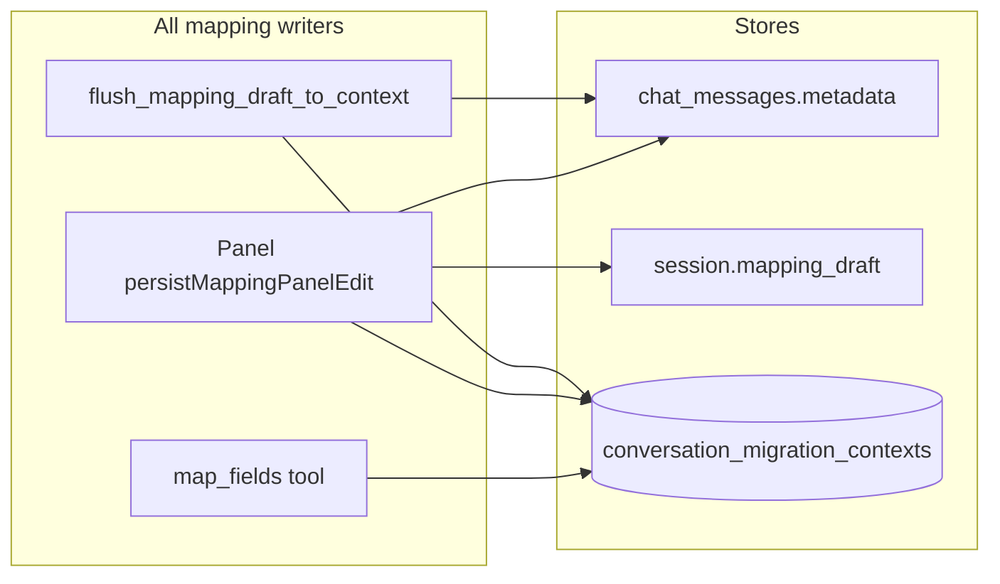
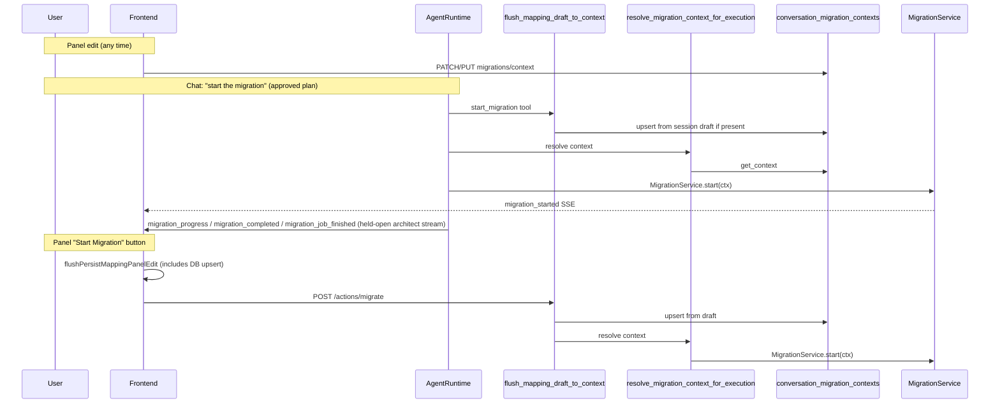

# Mapping Context & Agentic Migration — Implementation Plan

**Status:** Planning (2026-06)  
**Scope:** Canonical mapping sync, unified migrate execution, continuation routing hardening  
**Related:** [MAPPING_EXECUTOR_ARCHITECTURE.md](./MAPPING_EXECUTOR_ARCHITECTURE.md) — endpoint resolution at plan time; mapping executor field-wires pinned entities only.  
**Not in scope:** Hotfixes that merge stale DB + fresh chat at read time without fixing writes

> **Live SSE contract (2026-06):** For current migration event order, terminal chat merge, and frontend handlers, see [ARCHITECTURE.md](./ARCHITECTURE.md) and [frontend ARCHITECTURE.md](../../../edisonai-frontend/docs/ARCHITECTURE.md). This document is the implementation plan; some sections describe phases already shipped.

---

## Problem statement

Today mapping lives in **three stores**, but migrate reads only one — and the UI never updates that store after `map_fields`:

| Store | Written by | Read at migrate? |
|-------|------------|------------------|
| React `mappingPanels` | Panel edits | No |
| Session `mapping_draft` + chat `mapping_started` metadata | `persistMappingPanelEdit`, `flush_mapping_draft_to_chat` | Partially (fallback only) |
| **`conversation_migration_contexts` (DB)** | **`map_fields` tool only** | **Yes — wins when present** |

Symptoms:

- User edits mapping in v2 panel (e.g. 11 fields); migrate runs with stale DB snapshot (e.g. 6 fields).
- Duplicate-key / wrong write-policy failures (`insert` instead of upsert when `is_duplicate_check` was added in UI).
- Chat “start the migration” after map v2 can crash classification (`'dict' object has no attribute 'strip'`).
- **`AGENT_EXECUTE_MIGRATION`** (not in `.env`) defaults off → `start_migration` returns `prompt_start_migration` → frontend re-orchestrates via `/actions/migrate`, which also reads stale DB. This is hybrid execution, not fully agentic.

`AGENT_UNIVERSAL_RUNTIME` was removed — execution is plan-scoped via `AgentRuntime` only (`agent/runtime.py`).

---

## Goals

| Goal | Success criteria |
|------|------------------|
| Single canonical mapping store | Every mapping mutation upserts `conversation_migration_contexts` with bumped `mapping_version` |
| Panel edits reach migrate | Edit 11 fields in panel → `StartMigrationTool` / `/actions/migrate` both see 11 fields |
| Fully agentic migrate on approved plans | `start_migration` tool always runs `MigrationService.start`; no env gate |
| Unified resolution | One resolver used by tools, migrate action, and save-flow flush |
| Robust continuation | “Start the migration” after cancel/map v2 → continuation plan, no classifier crash |
| Minimal env surface | Remove dead execution flags; sensible code defaults for agent tuning |

---

## Target architecture

### Data flow (write path)



**Rule:** DB is canonical **because every writer updates it**. Chat metadata and session draft are caches for UI/hydration, not competing sources of truth.

### Execution flow (read + migrate path)



### Resolution contract

Introduce one backend entry point:

```python
async def resolve_migration_context_for_execution(
    *,
    user_id: str,
    conversation_id: str,
    job_id: str,
    session: Optional[AgentSession] = None,
) -> Optional[MigrationContext]:
    """
    1. flush_mapping_draft_to_context (chat + DB)
    2. resolve_migration_context_for_tool (DB → lineage → session → chat fallback)
    3. enrich_migration_context (connectors, transport)
    """
```

Both **`StartMigrationTool`** and **`run_migrate_action`** must call this — not raw `get_context` after chat-only flush.

---

## Implementation phases

### Phase 1 — Backend: draft flush writes DB

**Objective:** Any commit point that flushes draft also upserts canonical context.

#### 1.1 Add `flush_mapping_draft_to_context`

**File:** `services/conversation/actions/mapping_draft.py`

- Keep `flush_mapping_draft_to_chat` (or rename internally).
- Add `flush_mapping_draft_to_context(user_id, conversation_id, *, job_id, mapping_message_id)`:
  1. Load session draft + resolve `job_id` / `mapping_message_id`.
  2. Update chat metadata (existing logic).
  3. Build `MigrationContext` from draft + session + chat metadata anchors:
     - `mapping` from `draft.mapping_config`
     - `transformation_rules`, `table_name`, `migration_rules`, `destination_object_api_name`
     - Destination/connector fields from session or existing DB row (load via `get_context` first if row exists).
  4. If DB row exists → `patch_context(mapping=..., transformation_rules=..., ...)`.
  5. If no row → `upsert_context` with minimum required fields (`document_type`, `destination`, etc. from chat metadata or session).
  6. Return `{ chat_updated, context_version, mapping_field_count }` for logging.

**Edge cases:**

- Draft empty → no-op (return early).
- No DB row and insufficient metadata for upsert → log warning; chat flush still succeeds (panel PUT should have created row).
- Preserve `mapping_id` from chat message metadata when upserting.

#### 1.2 Wire flush at all commit points

| Caller | File | Change |
|--------|------|--------|
| Migrate action | `services/conversation/actions/migrate.py` | Replace `flush_mapping_draft_to_chat` + `get_context` with flush + `resolve_migration_context_for_execution` |
| Save flow | `services/conversation/actions/save_flow.py` | Same flush function (already calls chat flush) |
| Start migration tool | `agent/tools/map_migrate_tools.py` | Call flush before resolve |

#### 1.3 Unified resolver

**File:** `services/migration/session_migration.py`

- Add `resolve_migration_context_for_execution` (see contract above).
- Update docstring on `resolve_migration_context_for_migrate`: DB is canonical when all writers sync; HTTP body only backfills transport gaps.
- Optional: deprecate direct `get_context` usage in migrate action (grep and replace).

**Acceptance:**

- Unit test: draft with 11 fields + stale DB with 6 → after flush, `get_context` returns 11.
- Unit test: `run_migrate_action` uses resolver, not raw `get_context`.

---

### Phase 2 — Frontend: panel edits upsert DB

**Objective:** `persistMappingPanelEdit` uses existing helpers that were never wired.

#### 2.1 Wire migration context API

**File:** `edisonai-frontend/src/architect/persistMappingPanelEdit.js`

After session draft PATCH, add:

```javascript
// PATCH first (row exists after map_fields)
try {
  await api.patch(
    `/conversations/${conversationId}/migrations/context?job_id=${jobId}`,
    buildMigrationContextPatchBody(entryMetadata, panel, updatedMapping, transformationRules),
  );
} catch (err) {
  if (err?.response?.status === 404) {
    await api.put(
      `/conversations/${conversationId}/migrations/context`,
      buildMigrationContextUpsertBody(entryMetadata, panel, updatedMapping, transformationRules),
    );
  } else {
    throw err;
  }
}
```

- On success, patch local `entryMetadata.mapping_version` if returned (optimistic concurrency for rapid edits).
- Debounced `schedulePersistMappingPanelEdit` and `flushPersistMappingPanelEdit` both hit DB.

#### 2.2 Tests

**File:** `edisonai-frontend/src/architect/persistMappingPanelEdit.test.js`

- Assert PATCH called with correct body on edit.
- Assert PUT on 404.
- Assert field count in patch body matches `updatedMapping` keys.

**Acceptance:**

- Manual: edit mapping in panel → GET `/migrations/context?job_id=...` shows updated fields before migrate.
- E2E-ish: `flushPersistMappingPanelEdit` before panel migrate → backend field_count matches panel.

---

### Phase 3 — Fully agentic migrate execution

**Objective:** Remove `AGENT_EXECUTE_MIGRATION` bifurcation; backend always executes when tool runs.

#### 3.1 `StartMigrationTool` changes

**File:** `agent/tools/map_migrate_tools.py`

- Remove `AGENT_EXECUTE_MIGRATION` checks and `prompt_start_migration` branch.
- Always call `MigrationService.start` when mapping is valid and audit passes.
- Keep user-visible actions: `migration_needs_mapping`, `migration_blocked_by_audit`, `migration_started`.
- Update `log_agent_runtime` payload: remove `execute_enabled`; add `mapping_field_count`, `mapping_version`, `source: db_context|draft_flush`.

#### 3.2 Frontend SSE handling

**Status (2026-06):** Shipped — see frontend [`ARCHITECTURE.md`](../../../edisonai-frontend/docs/ARCHITECTURE.md#migration-sse-two-entry-paths-one-contract).

**Files:**

- `edisonai-frontend/src/architect/dispatchArchitectSseEvents.js`
- `edisonai-frontend/src/architect/architectSse.js`
- `edisonai-frontend/src/architect/applyMigrationStreamToChat.js`
- `edisonai-frontend/src/architect/runMigrationStream.js`

- Agent and migrate-action paths share handlers: `migration_started` → progress → `migration_completed` (SSE `message` payload) → `migration_job_finished`.
- **`prompt_start_migration`:** removed; panel uses `executeChatMigration` → `/actions/migrate` when user clicks **Start Migration**.
- Fallback: `syncMigrationTerminalFromServer` / `syncPendingMigrationJobsAfterArchitectStream` only on reload or missing terminal SSE.

#### 3.3 `/actions/migrate` parity

**File:** `services/conversation/actions/migrate.py`

- Must produce same result as tool path (SSE stream via existing migrate stream handler).
- Use `resolve_migration_context_for_execution` → `MigrationService.start(ctx)`.
- Recompute `operation` via `resolve_write_policy` when draft patch changes duplicate-check flags (ensure `patch_context` / flush path preserves or recomputes `operation` on mapping change).

**Acceptance:**

- Test: `StartMigrationTool` with `conversation_id` → `action == migration_started`, not `prompt_start_migration`.
- Chat “start migration” on approved plan → migration job starts without frontend calling `/actions/migrate`.

---

### Phase 4 — Continuation & classification hardening

**Objective:** Fix continuation gap and metadata type crashes without changing product behavior.

#### 4.1 Load `job_context` when route is continuation

**File:** `services/intent/classify_and_enrich.py`

After `route_planning_path`:

```python
if route == "continuation_path" and job_context is None and not attached_file:
    job_id = (
        getattr(session_decision, "job_id", None)
        or (conv_session.active_job_id if conv_session else None)
        or _resolve_job_id_hint(...)
    )
    if job_id:
        job_context = await load_job_context(...)
```

Then enter `plan_from_job_context` when `job_context` is not None.

Add log: `[classify_and_enrich] continuation_path job_id=... (loaded_late=...)`.

#### 4.2 Coerce metadata strings

**File:** `services/planning/conversation_session.py`

Add `_coerce_resource_str(value) -> str` and use in:

- `is_unknown_resource`
- `_event_job_id`
- `inherit_session_resources_from_intent_state` (destination/source fields)

Handle `dict` shapes from map v2 / intent_state (e.g. `{ "name": "...", "id": "..." }`).

**Optional audit:** grep for `(meta.get(...) or "").strip()` on destination/source/job_id fields in intent pipeline.

**Acceptance:**

- Test: continuation route with `job_context=None` but `session_decision.job_id` set → `plan_from_job_context` called.
- Test: metadata `destination={"name":"My DB"}` → no exception in classify path.

---

### Phase 5 — Env & dead code cleanup

**Objective:** Align runtime with minimal `.env` policy.

| Item | Action |
|------|--------|
| `AGENT_EXECUTE_MIGRATION` | Remove from code and tests |
| `AGENT_UNIVERSAL_RUNTIME` | **Done** — removed; plan-scoped `AgentRuntime` only |
| `prompt_start_migration` | Remove from terminal extraction allowlist once frontend updated |
| `agent/universal_runtime.py` | **Done** — deleted |
| `handlers/post_extract_operations.py` | **Done** — deleted |

Keep operational tuning env vars (`AGENT_MAX_STEPS_PER_TURN`, `PLANNER_DEBUG`, etc.) with **code defaults** documented in `MODULES.md` — not required in `.env`.

---

### Phase 6 — Tests & documentation

#### 6.1 Backend tests

**Extend:** `tests/test_mapping_edit_context_sync.py`

| Test | Assert |
|------|--------|
| `flush_mapping_draft_to_context_updates_db` | Draft 11 fields, DB 6 → after flush DB has 11 |
| `run_migrate_action_uses_fresh_draft` | migrate action field count = draft count |
| `start_migration_executes_without_env_flag` | `migration_started`, `MigrationService.start` called |
| `resolve_write_policy_after_panel_duplicate_check` | mapping with `is_duplicate_check` → upsert |

**New:** `tests/test_classify_continuation_job_context.py`

- Continuation path loads late `job_context`.
- Dict metadata does not crash `is_unknown_resource`.

#### 6.2 Frontend tests

- `persistMappingPanelEdit.test.js` — API wiring (Phase 2).

#### 6.3 Docs

**Update:**

- `docs/ARCHITECTURE.md` — canonical mapping store, single migrate execution path, remove universal runtime references.
- `docs/MODULES.md` — `mapping_draft.py`, `migration_context_routes.py`, resolver entry point.

---

## File change checklist

### Backend (create/modify)

| File | Phase | Change |
|------|-------|--------|
| `services/conversation/actions/mapping_draft.py` | 1 | `flush_mapping_draft_to_context` |
| `services/conversation/actions/migrate.py` | 1, 3 | Unified resolver |
| `services/conversation/actions/save_flow.py` | 1 | Use context flush |
| `services/migration/session_migration.py` | 1 | `resolve_migration_context_for_execution` |
| `agent/tools/map_migrate_tools.py` | 1, 3 | Flush + remove env gate |
| `services/intent/classify_and_enrich.py` | 4 | Late job_context load |
| `services/planning/conversation_session.py` | 4 | `_coerce_resource_str` |
| `tests/test_mapping_edit_context_sync.py` | 6 | New cases |
| `tests/test_classify_continuation_job_context.py` | 6 | New file |
| `docs/ARCHITECTURE.md` | 6 | Architecture update |

### Frontend (modify)

| File | Phase | Change |
|------|-------|--------|
| `src/architect/persistMappingPanelEdit.js` | 2 | PATCH/PUT migrations/context |
| `src/architect/persistMappingPanelEdit.test.js` | 2 | API tests |
| `src/architect/dispatchArchitectSseEvents.js` | 3 | Deprecate prompt_start_migration branch |
| `src/architect/architectSse.js` | 3 | Event list cleanup |

---

## Rollout strategy

1. **Phase 1 + 2 together** — fixes root cause (writes). Safe to deploy; backward compatible.
2. **Phase 3** — behavior change for chat migrate (backend executes). Verify SSE consumers handle `migration_started` without duplicate migrate calls from `onMigrateDataPrompt`.
3. **Phase 4** — low risk; deploy with Phase 1–3 or immediately after.
4. **Phase 5** — cleanup PR after soak.
5. **Phase 6** — ongoing with each phase; complete before marking done.

**Monitoring:**

- Log `mapping_field_count` and `mapping_version` at `start_migration.resolve` and `run_migrate_action`.
- Alert on mismatch: panel metadata field count ≠ DB field count at migrate time (debug metric).

---

## Out of scope (explicit)

- Read-time “pick freshest of DB vs chat vs draft” without write sync — rejected as hotfix.
- Re-enabling UniversalRuntime or post-extract bypass routes.
- New env flags for mapping sync or agent execution.
- Changing credit/billing or migration batch engine beyond write-policy correctness.

---

## Risks & mitigations

| Risk | Mitigation |
|------|------------|
| PATCH 404 before first `map_fields` | Frontend PUT fallback; map_fields always creates row in normal flow |
| Version conflict on rapid edits | PATCH uses optional `expected_version`; on 409, refetch and retry once |
| Double migration (agent + frontend) | Phase 3 removes `prompt_start_migration`; ensure `onMigrateDataPrompt` no-ops when `migration_started` already handled |
| Save-flow reads stale mapping | Phase 1 includes save_flow in flush wiring |
| Missing `document_type` on PUT from panel | Upsert body already includes fields from `entryMetadata`; validate in test |

---

## Definition of done

- [x] Panel edit → DB context field count matches panel before any migrate path runs.
- [x] Chat approved plan “start migration” executes on backend with correct mapping (no stale 6-field snapshot).
- [x] Panel “Start Migration” button works via `/actions/migrate` with same mapping.
- [x] No `AGENT_EXECUTE_MIGRATION` in codebase.
- [x] Continuation after map v2 does not crash classification.
- [x] Tests listed in Phase 6 pass.
- [x] `ARCHITECTURE.md` reflects single canonical store + agentic migrate execution.
- [x] Phase 5 cleanup: `prompt_start_migration`, `AGENT_UNIVERSAL_RUNTIME`, `post_extract_operations.py` removed.

---

## Estimated effort

| Phase | Effort |
|-------|--------|
| 1 — Backend flush + resolver | 1–2 days |
| 2 — Frontend wire API | 0.5 day |
| 3 — Agentic execution | 0.5–1 day |
| 4 — Continuation hardening | 0.5 day |
| 5 — Cleanup | 0.5 day |
| 6 — Tests + docs | 1 day |
| **Total** | **~4–5 days** |

Phases 1–2 should ship together; they deliver the core fix. Phases 3–4 complete the “fully agentic, no hotfix” bar.
