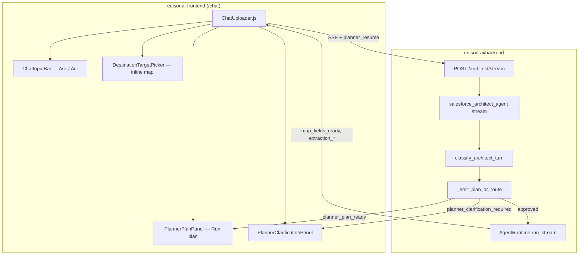
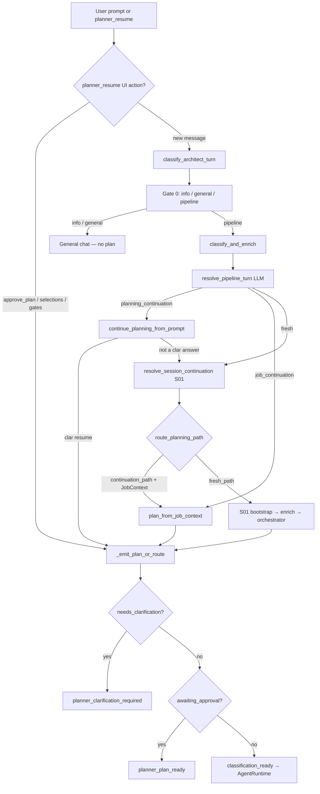
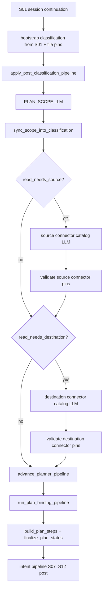
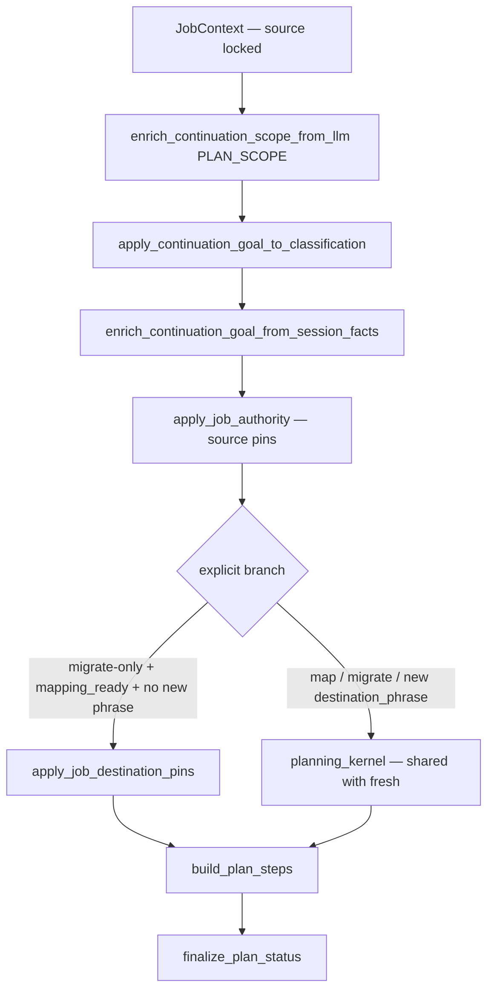
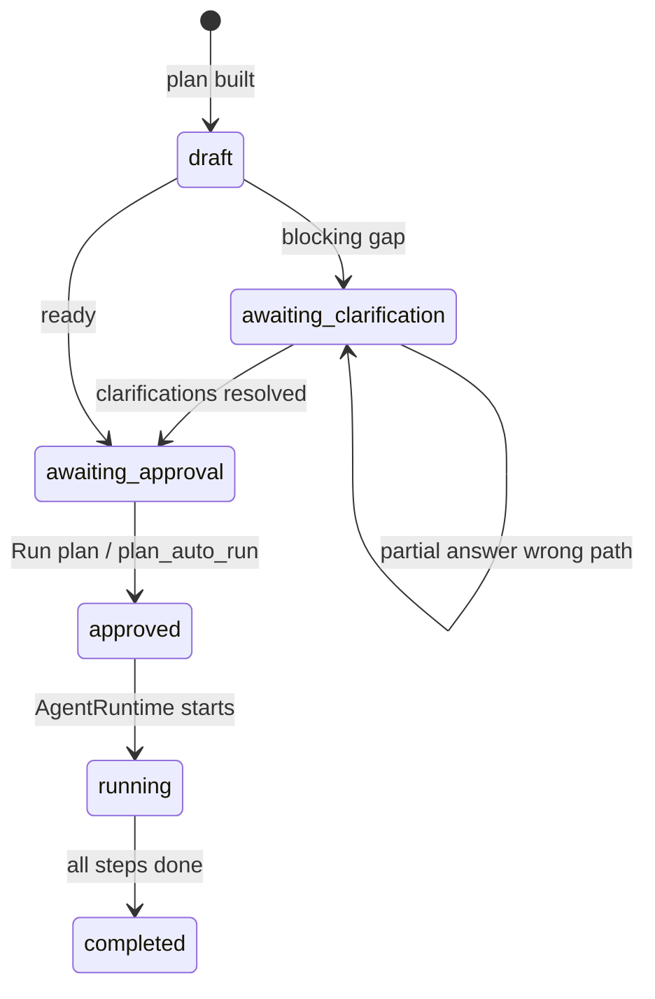
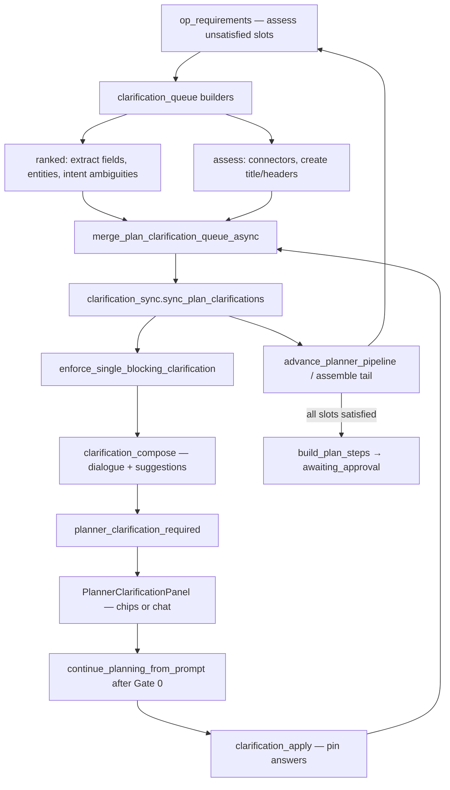
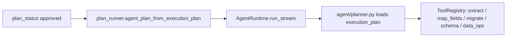

# Archian AI — System Architecture

**Status:** Canonical (2026-06)  
**Audience:** Engineers and coding agents changing intent, planning, migration, or architect chat.

Implement only from this file, `MODULES.md`, and `AGENTS.md`. Do not use stale `*_IMPLEMENTATION_PLAN.md` files elsewhere in the repo.

**Naming:** The product uses **execution plan** / **planning pipeline**. Legacy name `planner_v2` (old logs/tests) refers to this same pipeline — no separate v1/v2 codepath. Internal module identifiers may still use `edison_*` / `/edison/*` paths.

### Glossary (deprecated internal names)

| Deprecated | Use instead |
|------------|-------------|
| Planner v2 | Planning pipeline |
| `planner_v2` / `[planner_v2]` logs | `edison.planning` / `[planning]` |
| `intent_pipeline_v2` | Intent pipeline (S01–S12, fresh path) |
| `pipeline_action` (e.g. `continue_map_migrate`) | `_continuation_steps` + `_plan_scope.operations` |
| `metadata.template` (e.g. `extract_map_migrate`) | `metadata.pipeline_steps` + `metadata.pipeline_label` |

---

## Repository layout

| Path | Role |
|------|------|
| `backend/` | FastAPI, intent, planning, agent runtime, connectors |
| `frontend/` | React architect chat (`/chat`), planner panels, destination picker |
| `e2e/` | Playwright smoke tests for planner panels |
| `docs/` | Architecture and module guides |

---

## Core principle

Archian AI is **agentic**, not template-driven:

1. **Understand** — Gate 0 + session continuation (S01). No slim classifier — scope and connector phrases come from PLAN_SCOPE only.
2. **Plan** — `PLAN_SCOPE` LLM → `_plan_scope` → `execution_plan.steps`.
3. **Bind** — catalog retrieve + `PLAN_BIND_*` LLM → `plan_contract`.
4. **Approve** — user clicks **Run plan** (Ask mode) or `plan_auto_run` (Act mode).
5. **Execute** — `AgentRuntime` + `plan_runner` → connector tools.
6. **Continue** — next turn uses `JobContext` (no re-extract unless user asks).

**Do not add keyword/regex routing for operations or destination resolution on the planning path.**  
Legacy architect shortcuts, `UniversalRuntime`, post-extract bypass, and regex destination resolution have been removed — all pipeline turns use PLAN_SCOPE → plan assembly → approved execution.

---

## End-to-end system diagram



---

## Backend request lifecycle



| Route | When | Planner entry |
|-------|------|----------------|
| `info_path` / `general_path` | Gate 0 | No execution plan |
| `planning_continuation` | Pipeline turn LLM: user answers open planner gap | `pipeline_turn.continue_planning_from_prompt` → clar apply + resume kernel |
| `job_continuation` | Pipeline turn LLM: new work on extracted data in active job | `continuation_planning.plan_from_job_context` (direct; may emit clar) |
| `fresh_path` | Pipeline turn LLM: new pipeline goal | S01 bootstrap → `orchestrator.enrich_classification_with_planning` |
| `continuation_path` (legacy label on classification) | Job-scoped plan built | Same kernel as fresh; `plan.metadata.continuation = true` |

**Pipeline turn routing (`resolve_pipeline_turn`):** After Gate 0 chooses `pipeline`, gather context (open clar gaps, job summary, dialogue, stalled/extract/dismiss flags) and call **`PIPELINE_TURN_ROUTING` LLM only** — no pre-LLM branch shortcuts or post-LLM overrides. Latest user message is the primary signal.

**Clarification vs turn branch:** `awaiting_clarification` is a **plan state**, not a turn type. Fresh and job entry paths can emit `planner_clarification_required`; the **next** user message answering a gap should route to **`planning_continuation`**, even when the plan is job-backed (`continuation: true` on pending).

**Entry modules:** `main.py` → `salesforce_architect_agent.handle_text_prompt_for_architect_agent_stream_real` → `clarification_turn.classify_architect_turn`.

---

## Fresh path (new extract / new source)



**Removed (2026-06):** slim classifier LLM (`classify.py`), `normalize_classifier_for_planning`, and `label_aware_resolver` connector binding. Connector instance resolution is catalog LLM + validation in `planning_kernel` only.

Runs **intent pipeline pre** (S01–S06) before orchestrator and **post** (S07–S12) after plan merge via `services/intent/enrich.py`.

---

## Continuation path (map / migrate after extract)

**Principle:** Separate **route** from fresh, shared **planning kernel** (LLM scope → LLM bind → validate → clarify → assemble). Full phased plan: [`CONTINUATION_PLANNING_KERNEL.md`](CONTINUATION_PLANNING_KERNEL.md).

**Does not run** the full S01–S12 intent pipeline overlay — entry is `plan_from_job_context` only.

### Target (shared kernel)



Kernel steps (fresh and continuation): `resolve_source_connector_via_llm` (when `needs_source`) → `resolve_destination_connector_via_llm` (when `needs_destination`) → `validate_classification_resources` → `advance_planner_pipeline` → binding tail → slot clarifications (`op_requirements` + `clarification_queue`). **No** keyword routing, slim classifier, or label-aware connector binding.

Structured logs: `[continuation_plan_scope]` (PLAN_SCOPE fields), `[continuation_bind] stage=connector|entity|binding skipped=<reason>`.

### Connector vs entity (three layers)

Planning separates **connector instance**, **entity** (object / table / workbook+tab), and **create metadata** (new spreadsheet title). LLM picks from catalog JSON; code only validates pins.

| Layer | Salesforce | SQL | Google Sheets |
|-------|------------|-----|---------------|
| **Connector** (org / DB / account) | `source_name` / `destination_name` = org | connection display name | `google_sheets_connection_id`, `*_account_name` |
| **Entity** (object / table / workbook+tab) | `*_object_api_name` | `*_table_name` | `*_spreadsheet_id`, workbook name, `*_sheet_name` |
| **Create** (when `create` in ops or `create_destination`) | — | — | `CREATE_TITLE` → `create_workbook_name`; headers via `spreadsheet_header_source` |

| Layer | Fresh / continuation resolver | Clarification types |
|-------|------------------------------|---------------------|
| **Source connector** | `llm_resolve_source_connector` → `apply_source_connector_pick` | `pick_salesforce_org`, `pick_sql_connector`, `pick_google_account` (source) |
| **Source entity (GS)** | `pick_source_workbook` + `resolve_and_apply_google_sheets_source_workbook` | `pick_source_workbook` (`source_entity` slot) |
| **Source entity (SF/SQL)** | `run_plan_binding_pipeline` / `PLAN_BIND_SOURCE` | `pick_source_entity` |
| **Destination connector** | `llm_resolve_destination_connector` → `apply_destination_connector_pick` | `pick_google_account`, `pick_salesforce_org`, `pick_sql_connector` |
| **Destination entity (GS migrate/map)** | `pick_workbook` + `resolve_and_apply_google_sheets_workbook` | `pick_workbook` (`destination_entity` slot); **create new** chip → `create_destination` + `create` op |
| **Destination entity (SF/SQL)** | `bind_destination_target_llm` | `pick_destination_entity` |
| **Create title (GS)** | `CREATE_TITLE` slot | `create_workbook_name` |

**Google Sheets connector LLM** receives **account catalog only** (`build_connector_catalog_for_llm`) — not workbook rows. Workbook/tab binding runs at the **entity** layer after the account is pinned (`google_sheets_account_slot_satisfied`). `validate_destination_connector_pins` / `validate_source_connector_pins` pass for GS when the account is validated; `planner_*_confirmed` for full extract/migrate endpoint requires workbook resolution (`gsheets_workbook_*_resolved`).

**Emit recovery:** `plan_emit_recovery.try_recover_empty_plan_at_emit` re-attaches slot clarifications (including `pick_workbook`) with catalog before `empty_plan_no_steps`.

**Clarification reuse:** Multi-turn map clarification reuses a pinned connector when `planner_pending` / `awaiting_clarification` and endpoint is resolved (`should_skip_destination_llm` → `clarification_connector_pinned`).

### Job context rules

| User intent | Resolution |
|-------------|------------|
| `destination_same_as_source: true` (PLAN_SCOPE) | Pin destination from `job.source` after validation — not before connector LLM |
| `destination_phrase` names org / DB / account | Connector catalog LLM → validate → bind |
| `destination_phrase` names GS workbook (map/migrate) | Connector LLM picks account when ambiguous → entity slot emits `pick_workbook` or DB/catalog workbook resolve |
| `create_destination` / `create` in ops | `CREATE_TITLE` + optional `CREATE_HEADERS`; account → title → plan (export uses `from_extraction` headers) |
| Migrate after map (`mapping_ready`, no new phrase) | `apply_job_destination_pins` from `JobContext` — no connector re-pick |
| Entity not named | Binding shortlist + clarify — not job entity default |

**Removed (planning path):** regex destination picks and keyword sheet finders — use PLAN_SCOPE + catalog LLM instead.

---

## Plan states and UI



| `plan_status` | Frontend panel | Backend SSE |
|---------------|----------------|-------------|
| `awaiting_clarification` | `PlannerClarificationPanel` | `planner_clarification_required` |
| `awaiting_approval` | `PlannerPlanPanel` — “Execution plan (review and approve to continue)” | `planner_plan_ready` |
| `approved` / `running` | Operation preview + inline extract/map/migrate | `agent_step_*`, `map_fields_ready`, … |

**Ask vs Act:** `plan_auto_run` on `POST /architect/stream`. Ask = pause for approval; Act = auto-run when plan is ready.

**Resume payload:** `planner_resume: { planner_pending, approve_plan?, selections?, … }` — see `clarification_turn.is_explicit_planner_ui_resume`.

**Plan dismiss:** `POST /chat/conversations/{id}/plan-dismiss` persists `plan_dismissed` (closes draft, not thread). Next turn uses normal routing + history.

### Conversational clarification loop (2026-06)

**Principle:** Code decides *what* is missing (`op_requirements` slots); ranked builders materialize catalog-backed pickers; `clarification_sync` is the **sole writer** to `plan.clarifications`; the LLM decides *how* to ask (`clarification_compose`); the user confirms; the pipeline loops until slots are satisfied.



| Layer | Module | Role |
|-------|--------|------|
| Slot compiler | `op_requirements.py` | Detect unsatisfied slots; assess emits placeholder gaps (`"<compose>"`) |
| Queue / merge | `clarification_queue.py` | `build_requirement_clarifications`, `build_ranked_slot_clarifications`, `build_entity_slot_clarifications`, `merge_plan_clarification_queue_async` |
| Single writer | `clarification_sync.py` | `sync_plan_clarifications` — only path that writes open `plan.clarifications` during planning |
| Binding / assembly | `binding/pipeline.py`, `plan_assembly.py` | Update `migration_intent` / `plan_contract` only — no direct `plan.clarifications.append` |
| Continuation guard | `continuation_policy.py` | `should_supersede_pending_for_fresh_turn` — ranked-slot open clars block fresh supersede (UI panel kept); **not** pipeline turn routing |
| Pipeline turn | `pipeline_turn_routing.py` | LLM-only: `planning_continuation` \| `job_continuation` \| `fresh` after Gate 0 |
| Dialogue | `clarification_compose.py` | `PLAN_CLARIFICATION_COMPOSE` → prompt, `context_summary`, suggestion chips |
| Reply parse | `clarification_reply_routing.py`, `binding/clarification_resolve.py` | Resume-before-Gate-0; free-text + chip parsing |
| Apply | `clarification_apply.py` | Pin answers; re-merge queue |
| Header policy | `source_column_headers.py` | PLAN_SCOPE `spreadsheet_header_source`; slot satisfaction; shared job column resolver |
| Title policy | `create_metadata.py` | Reject generic titles (`Google Sheet`); inferred titles stay suggested until confirmed |

**Ranked slots** (`EXTRACT_FIELDS`, `SOURCE_ENTITY`, `DESTINATION_ENTITY`): `assess_plan_requirements` records the gap; `clarification_queue` builders materialize full `Clarification` objects (catalog options, field hints). Ranked clars win over assess placeholders on merge.

**Fresh supersede:** When pipeline turn LLM returns **`fresh`**, `supersede_pending_for_fresh_turn` may attach `_fresh_supersedes_pending` so the frontend dismisses a stale clar panel — unless open ranked-slot clars would be lost (`should_supersede_pending_for_fresh_turn` returns false). Turn routing does **not** force `planning_continuation` for ranked slots; the LLM decides the branch.

**Create header policy (PLAN_SCOPE `spreadsheet_header_source`):**

| Value | Meaning | `pick_create_headers` |
|-------|---------|----------------------|
| `from_extraction` | Reuse columns from extract step or active job (export / continuation new sheet) | No |
| `from_user` | Blank new sheet — user supplies columns via clarification | Yes until pinned |
| `user_specified_inline` | User named columns in this turn | No |

**Create slot order (export / from_extraction):** Google account → spreadsheet title → execution plan. Headers load from the same extraction job keys mapping uses (`build_create_header_contract`).

**Create slot order (migrate to existing GS sheet):** Google account → `pick_workbook` (existing workbook or **create new**) → map/migrate plan. Choosing **create new** on `pick_workbook` sets `create_destination` and inserts `create` into pipeline ops (`arm_create_destination_from_user_choice`).

**Create slot order (standalone create / from_user):** destination connector → column headers → spreadsheet title → execution plan.

**Execution:** `google_sheets_create_from_prompt` is contract-driven when the approved plan passes `create_contract` — no fallback LLM re-parse. Create with `use_extraction_headers` waits for extract completion via `plan_execution_gates` (`depends_on: ["extract"]`).

**Invariant:** Every blocking clarification must have composed user-facing copy before SSE emit (`clarification_compose.enrich_blocking_clarification_on_plan` or `resolve_clarification_display_message` fallback). Empty prompts must not reach the UI.

**Do not add** fixed create-clarification strings outside `clarification_compose._fallback_prompt`. CI: `scripts/audit_keyword_routing.py`.

---

## Execution (approved plan)



| Layer | Module |
|-------|--------|
| Planning `ExecutionPlan` | `services/planning/schemas.py` — in `classification["execution_plan"]` |
| Runtime `ExecutionPlan` | `agent/plan.py` — built by `Planner` / `plan_runner` |
| Step args refresh | `services/planning/plan_runner.py` |
| Tool dispatch | `agent/runtime.py`, `services/planning/operation_resolver.py` |
| Map / migrate | `agent/tools/map_migrate_tools.py`, `services/migration/` |

### Migrate write mode (2026-06)

Linear pipeline: **extract → map → `transform_data_for_migration` → migrate**. Write mode is **not** chosen from same/cross connector pairing.

| Priority | Rule | Module |
|----------|------|--------|
| 1 | Explicit `operation` on `MigrationContext` | `write_policy.resolve_write_policy` |
| 2 | Any mapped field with `is_duplicate_check` → **upsert** (query destination, update or insert) | `write_policy.py`, destination runners |
| 3 | Default: GSheets `append`, SQL `insert`, Salesforce `upsert` | `write_policy.py` |

SQL also promotes `insert` → `upsert` in `DatabaseMigrationService._determine_operation` when duplicate-check key columns exist.

**Removed from write decisions:** `same_entity_migration`, `plan_contract.same_entity_migration`, same/cross connector policy flags.

### Planning intent vs structural flags (2026-06)

| Keep (LLM / user intent) | Removed as planning policy |
|--------------------------|----------------------------|
| `destination_same_as_source` (PLAN_SCOPE round-trip) | `same_entity_migration` on plan contract |
| `destination_phrase`, `needs_destination` | `connectors_cross_system()` slot gates |
| Job pins on continuation | `apply_continuation_endpoint_pins_from_job` + `JobContext` |

**Extract portability:** `extract_field_scope.extract_portability_context()` derives heterogeneous source/dest from resolved endpoints (for Id/lookup guardrails), not a global `cross_system` migrate policy.

**Destination entity slots:** `op_requirements._destination_entity_slot_applies()` — require entity bind when goal needs destination and not `destination_same_as_source`.

**Single execution path:** Pipeline turns run fixed `execution_plan` steps via `AgentRuntime` / `plan_runner` only. Legacy `UniversalRuntime`, post-extract bypass, and `prompt_start_migration` (frontend re-orchestration) are removed.

**Fully agentic migrate (2026-06):** Approved plans run `start_migration` on the backend → `MigrationService.start` → background migration job. The architect stream emits `migration_started` (via tool `sse_chunks` + `agent_step_completed`), then **`AgentRuntime._stream_migration_job_sse`** holds the connection open with the same terminal contract as migrate-action SSE: `migration_progress`, DB-backed `migration_completed` (+ optional recovery), `migration_job_finished` (`utils/migration_sse_stream.py`, `ChatService.find_persisted_data_event`). Panel **Start Migration** calls `POST /actions/migrate` (same resolver, user-initiated — not a second agent hop). No `AGENT_EXECUTE_MIGRATION` or `AGENT_UNIVERSAL_RUNTIME` env flags.

---

## LLM tasks

| Task | Module | Purpose |
|------|--------|---------|
| `plan_clarification_compose` | `clarification_compose.py` | Contextual clarification question + suggestion chips |
| `plan_clarification_reply` | `clarification_reply_routing.py`, `binding/clarification_resolve.py` | Resume thread + parse free-text replies |
| `plan_scope` | `goal_parser.enrich_scope_from_llm` / `enrich_continuation_scope_from_llm` | Ops, `needs_source`, `needs_destination`, phrases, multi-source |
| `plan_bind_source` | `binding/bind_source.py` | Source entity + field scope |
| `plan_bind_destination` | `binding/bind_destination.py` | Destination entity + fields |
| Session continuation | `intent/session_continuation.py` | Fresh vs continue + phase |
| Source connector pick | `source_llm_resolve.py` | Source connector from catalog when `needs_source` |
| Destination connector pick | `destination_llm_resolve.py` | Destination connector from catalog when `needs_destination` |

**Removed:** `classification` LLM task (slim classifier deleted). PLAN_SCOPE + catalog bind LLMs are the sole scope and connector-instance authority on the fresh path.

---

## Intent pipeline (fresh path only)

Mirrors planner state for UI/gaps on **fresh** turns. Continuation planning skips this overlay.

| Step | Role |
|------|------|
| S01 | Session continuation (also used before route in `classify_and_enrich`) |
| S02 | Turn type (S03 goal summary merged into S02 in code) |
| S04 | Destination need |
| S06 | Bind resources (**legacy regex — do not extend**) |
| S07–S08 | Entity + field scope from `plan_contract` when bound |
| S10 | Gaps → clarifications |
| S11–S12 | Plan sketch + readiness |

Logs: `[intent_pipeline]` (fresh), `[planning]` (plan events), `[continuation_plan]` / `[continuation_plan_scope]` / `[continuation_bind]` (continuation).

---

## Frontend ↔ backend contract

**Endpoint:** `POST ${REACT_APP_API_URL}/architect/stream` (SSE)

**Request body (JSON):**

```json
{
  "prompt": "...",
  "conversation_history": [...],
  "conversation_id": "...",
  "plan_auto_run": false,
  "planner_resume": { "planner_pending": {}, "approve_plan": true }
}
```

**Key metadata on chat messages:**

- `metadata.event_type` — `planner_plan_ready`, `planner_clarification_required`, …
- `metadata.planner_pending` — restored on load for panel actions; must be in `conversation_history` for backend clarification resume
- `metadata.intent_state` — active extract session snapshot for S01 / continuation inherit

**Destination picker** (`DestinationTargetPicker`) is **inline** after extraction for map when destination still unknown — separate from planner plan panel.

---

## Session-first architect (2026-06)

Backend owns conversation session; the frontend sends **commands only** (`conversation_id`, `prompt`, action flags).

| Layer | Location | Role |
|-------|----------|------|
| Hot session | `services/conversation/session_store.py` | Redis `conv_session:{user_id}:{conversation_id}` — active job, intent_state, pipeline progress, mapping draft |
| Durable chat | `chat_messages.metadata` | Planner / extraction / mapping / migration events |
| Execution facts | `JobContext` + migration context | Extract/map/migrate pins at commit points |

**Context loading:** `_load_conversation_history` always reads DB (`get_messages_with_metadata_for_context`) when `conversation_id` is set. Client `conversation_history` is deprecated.

**Action APIs** (`handlers/conversation_actions.py`):

- `POST /conversations/{id}/actions/map|remap` — server-side map; writes `mapping_started` + session
- `POST /conversations/{id}/actions/migrate` — flush draft → canonical DB context → migrate SSE
- `POST /conversations/{id}/actions/save-flow` — `{ flow_name, job_id?, batch_id? }`; backend resolves source/dest/SOQL via `services/flow/save_context.py`
- `PATCH /conversations/{id}/session/mapping-draft` — debounced mapping edits (session draft)
- `PATCH/PUT /conversations/{id}/migrations/context` — canonical mapping store (`conversation_migration_contexts`); panel edits upsert here

**Canonical mapping (2026-06):** All mapping writers (`map_fields`, panel persist, draft flush at migrate/save) upsert `conversation_migration_contexts`. Migrate resolves via `resolve_migration_context_for_execution` (flush draft → DB → enrich). `start_migration` tool always executes `MigrationService.start` on the backend (no frontend re-orchestration for chat).

**Save flow (2026-06):** `POST /actions/save-flow` resolves extraction `job_id` from `{ job_id?, batch_id?, flow_name }` + chat metadata (`migration_completed.source_job_id`) before calling `resolve_flow_save_context`. Redis `active_job_id` is a fast path, not required.

**Continuation authority:** `services/intent/job_authority.py` re-locks source pins after destination resolution in `plan_from_job_context`.

Frontend architecture: [`edisonai-frontend/docs/ARCHITECTURE.md`](../../../edisonai-frontend/docs/ARCHITECTURE.md).

### Save-flow legacy removal (2026-06)

**Canonical path:** `POST /conversations/{id}/actions/save-flow` → flush mapping draft → `resolve_flow_save_context` (+ `migration_rules_resolve`) → `save_mapping_flow`.

| Removed / deprecated | Replacement |
|---------------------|-------------|
| Frontend `POST /save-mapping-flow` with full payload | Action API `{ flow_name, batch_id? }` only |
| `SaveFlowTool` inline SQL inserts | `run_save_flow_action` |
| `MigrationContext.connector_id` as source on save | Separate `source_connector_id` + `destination_id` in resolver |
| Frontend `resolveMigrationFlowContext` for save | Backend resolver (frontend helpers kept for migrate/display) |

**Migration rules on save (2026-06):** `services/flow/migration_rules_resolve.py` merges the richest `extraction_rules` across lineage chat events + `extraction_metadata` + embedded row rules; reads `missing_field_preference` and `mapping_transformation` from session mapping draft, `mapping_started`, and `MigrationContext`. SOQL/SQL + rules are persisted at extract (`extraction_metadata`) and post-extract child saves inherit parent query metadata.

**Google Sheets three-level destination (2026-06):** `services/planning/google_sheets_destination.py` + `destination_catalog_validate.py` + entity slots in `op_requirements.py`:

1. **Connector — account** — `llm_resolve_destination_connector` (connector catalog only). When `len(google_sheets_connections) > 1`, clarification emits `pick_google_account` → pins `google_sheets_connection_id` / `destination_account_name`. `mark_destination_validated_from_llm` sets connector flags only until workbook or create title is pinned.
2. **Entity — workbook + tab** — `DESTINATION_ENTITY` slot → `pick_workbook` (scoped to pinned account; includes **create new**). `GoogleSheetRef` rows carry `google_sheets_connection_id` for labels. Continuation workbook phrases resolve via `resolve_and_apply_google_sheets_workbook` after connector bind.
3. **Create — title** — when `create` / `create_destination`: `CREATE_TITLE` → `create_workbook_name` (export path skips `pick_create_headers` when `spreadsheet_header_source=from_extraction`).

**Source mirror:** `google_sheets_source.py` — account at connector LLM; `pick_source_workbook` at `source_entity` slot.

`destination_name` is a **workbook** name (never the Google account label). Mapping receives `destination_spreadsheet_id` + `google_sheets_connection_id`. Fresh path runs `resolve_destination_connector_via_llm` in `planning_kernel` when PLAN_SCOPE has `needs_destination`.

---

## Enterprise Graph medallion lake (EGA)

Lake layout is **proposal-only** inside Enterprise Graph — same pattern as warehouse proposals. Chat owns **data movement** into bronze.

| Layer | EGA artifact | Data |
|-------|----------------|------|
| Bronze (raw) | `raw__<member>__<entity>` table DDL in `lake_layout_proposals` | Loaded via **chat flows** → migrate to lake Snowflake member |
| Silver | `stg__*` view DDL | `UNION ALL` over bronze via semantic mappings |
| Gold | `warehouse_schema_proposals` | When `lake_enabled`, warehouse lineage reads **silver** catalog |

**Intelligence (2026-06):** Mapping, lake, and warehouse are **LLM-first** with rules fallback. Entity inventory for mapping/lake excludes `entity_class=metadata/system` via `connector_entity_semantics` (not hardcoded table-name regex). Cross-connector clusters are **pairwise** (one entity per connector). See `docs/ENTERPRISE_GRAPH_IMPLEMENTATION_PLAN.md`.

**Bronze naming:** `lake_designer.bronze_table_name()` — GSheets slugs from workbook/tab label, not `spreadsheet_id`. Full `entity_id` kept in `_archian_source_entity_id` lineage column.

**Boundary:** Assessment pipeline (`job_worker`) runs `lake_designer` when `settings.lake_enabled` and a `lake` graph member exist. Approve + execute DDL uses `/api/enterprise-graphs/.../lake-proposals/{id}/execute`. Do **not** route lake loads through `/architect/stream` or headless `MigrationService` in EGA v1.

**Run types:** `assessment`, `remap`, `warehouse_redesign`, `lake_redesign`.

---

## Invariants (do not break)

1. **One planning path** — no parallel template routers when `_plan_scope` present (`planner_path.py`). **`pipeline_action` and `metadata.template` are removed**; mechanical step order comes from `_continuation_steps` / `_pipeline_tokens` derived from PLAN_SCOPE.
2. **PLAN_SCOPE owns operations** — not `parse_goal` keywords.
3. **Continuation map/migrate** — same planning kernel as fresh (PLAN_SCOPE + catalog LLM + binding); separate route only. See [`CONTINUATION_PLANNING_KERNEL.md`](CONTINUATION_PLANNING_KERNEL.md). No regex destination picks.
4. **Source on continuation** — from `JobContext`; `should_skip_source_binding` skips re-bind.
5. **Approved plans execute** — `plan_status=approved` must reach `AgentRuntime`, not `skip_execute`.
6. **Connector before entity** — do not re-pick connector when only entity clarification is pending. GS: account connector slot can be satisfied while `pick_workbook` / `pick_source_workbook` remains open.
7. **GS connector LLM is account-only** — workbook catalog is not passed to `llm_resolve_*_connector`; entity layer owns workbook/tab.
8. **Clarification copy is LLM-composed** — slot gaps use `"<compose>"` in `op_requirements`; no hardcoded create/title prompts outside `clarification_compose` fallbacks.
9. **Create title confirmed** — `planner_spreadsheet_title_confirmed` required; generic titles (`Google Sheet`) do not satisfy `CREATE_TITLE`.

---

## Tests after planner changes

```bash
cd edison-ai/backend
python scripts/audit_keyword_routing.py
pytest tests/test_sf_export_new_sheet_flow.py \
       tests/test_gs_migrate_account_workbook_gap.py \
       tests/test_source_llm_resolve.py \
       tests/test_clarification_emit_invariant.py \
       tests/test_clarification_pipeline.py \
       tests/test_clarification_queue.py \
       tests/test_destination_catalog_validate.py \
       tests/test_planning_clarification_apply.py \
       tests/test_planner_session_loop.py \
       tests/test_google_sheets_account_clarification.py \
       tests/test_op_requirements.py \
       tests/test_plan_builder.py::test_sf_to_new_sheet_plan_steps \
       tests/test_plan_binding_create_only.py \
       tests/test_plan_extract_gates.py \
       tests/test_same_entity_migration.py \
       -q
```

See `tests/README.md` for tier definitions (clarification gate vs intent overlay vs legacy guardrails).
